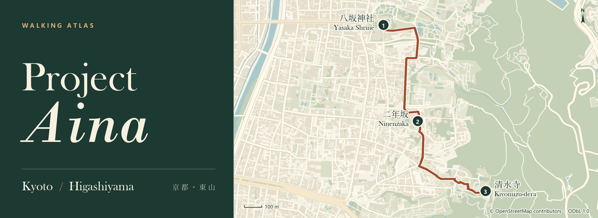
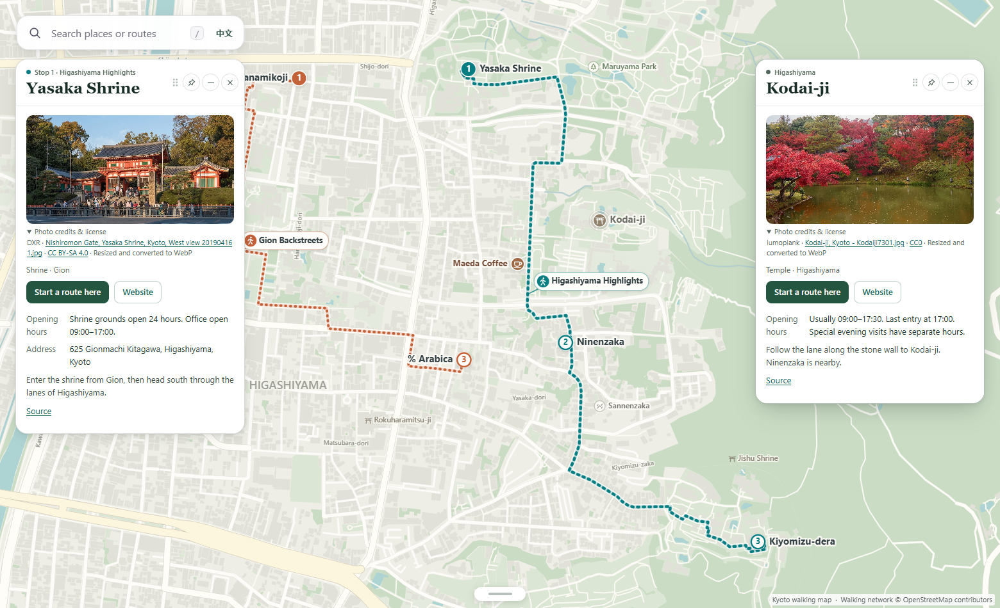
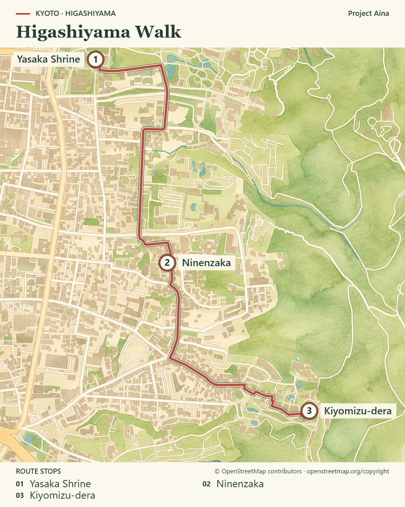
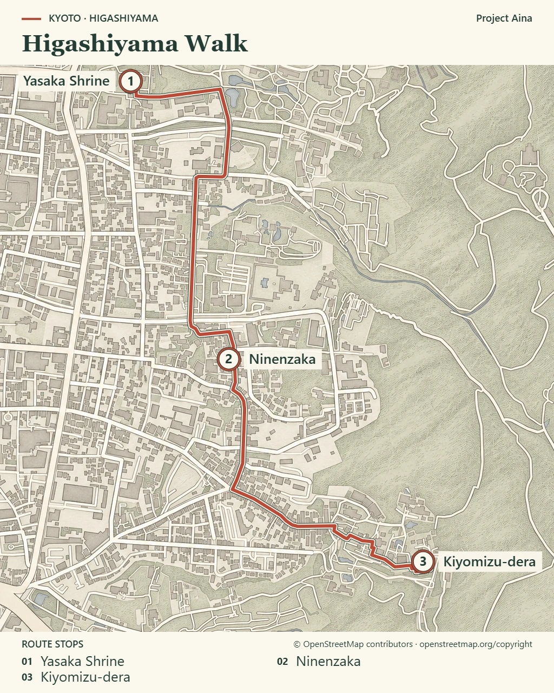
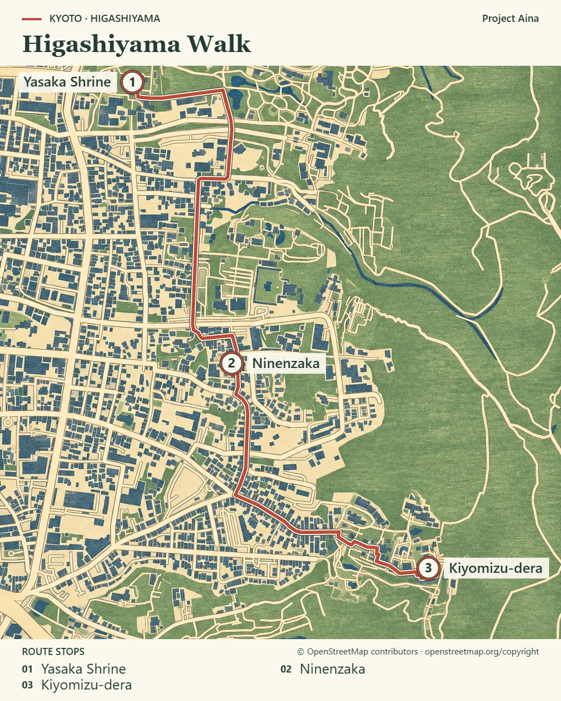

**English** · [简体中文](README.zh-CN.md)



You're walking from Yasaka Shrine to Kiyomizu-dera. There's a coffee shop near Ninenzaka you'd like to try. Pull up its photos beside the shrine's opening hours, trace the detour on the map, and decide whether to add a stop.

**Project Aina** is a walking atlas for travelers who like to plan their own routes. Your walk stays drawn along the streets while you explore. On a desktop, every place opens in a window you can move. On a phone, swipe up the bottom panel to plan the same walk.

## Take a walk through Kyoto

1. Select **Yasaka Shrine** on the map and choose **Start a route here**. A numbered marker appears immediately, and the new walk takes its name from the first stop.
2. Open **Ninenzaka**. On a desktop, the shrine's window stays open so you can compare the two places. Choose **Add to route** to draw the walk between them.
3. Choose **Finish route**, then explore nearby cafés. Click the line on the map or open **My routes** to reorder the stops, make a copy or pick up where you left off.



Two walks come with the atlas. **Higashiyama Highlights** follows Yasaka Shrine → Ninenzaka → Kiyomizu-dera. **Gion Backstreets** takes you from Hanamikoji through Kennin-ji to % Arabica Kyoto Higashiyama. Show both walks together or hide either one.

## Make a Kyoto route poster

Each print shows the same view of **Higashiyama Highlights**. Aina draws the walking line and numbered stops over each illustration. Open any print at full size to see the street detail.

| Japanese watercolor | Pen-and-ink sketch | Vintage woodblock |
| :---: | :---: | :---: |
| <a href="docs/images/art-watercolor.webp"><br>1024&nbsp;×&nbsp;1280&nbsp;px&nbsp;·&nbsp;WebP</a> | <a href="docs/images/art-ink.webp"><br>1024&nbsp;×&nbsp;1280&nbsp;px&nbsp;·&nbsp;WebP</a> | <a href="docs/images/art-woodcut.webp"><br>1024&nbsp;×&nbsp;1280&nbsp;px&nbsp;·&nbsp;WebP</a> |

Map data for all three prints © [OpenStreetMap contributors](https://www.openstreetmap.org/copyright).

Open a saved walk and choose **Map screenshot & art**.

- **Route poster** draws the walking line, stop numbers and names on the map. Edit the title and route color locally, then choose **Download route poster** for a 1024 × 1280 PNG.
- **Generate art print** sends the basemap and a transparent route guide to OpenAI to illustrate the walk in your chosen style. Only generation uses the image model, and each request may incur a charge. Switch between **Route poster** and **Art print** to compare them, then download either as a PNG.
- **Download Google Maps screenshot** is available on computers licensed and configured for internal Kyoto previews. It saves the original road map PNG with its attribution, framed around your stops. Shops and landmarks selected on the map or in search can frame the shot even when walking directions are unavailable. For a map of the area currently on screen, use **Map layers → Standard → Capture view**. The screenshot follows your label settings.

## Design notes

### Keep the walk in sight

Halfway through planning, you spot a café near Ninenzaka. Is it on the way? The line you just drew is what lets you answer. In Aina, opening a place and editing a walk are separate actions. You can check photos, opening hours or the café's website before choosing **Add to route**. The line is anchored to geographic coordinates, so you can zoom in and see exactly where you'd turn.

### Give the map some room

On a desktop, you might want the shrine's opening hours on the left, the café on the right, and the streets between them in clear view. Movable cards let you arrange that comparison yourself. On a phone, the same details slide up from the bottom, leaving the map a gesture away. Search is visible from the start. Tools for sorting stops, comparing places and managing walks appear when you open a card.

### Let a walk begin with one stop

Sometimes the whole plan is “I'd like to go there.” The first pin is enough to name and save a draft. A street-by-street line appears once you add a second stop. You can lay a morning walk through Higashiyama beside an afternoon in Gion to see where they come close, then duplicate a route to try another way through. An unfinished walk keeps its stop order for the next time you open it.

### Start at walking pace

In Higashiyama, two pins can sit a street apart while the way in takes you around a temple wall and up a flight of stone steps. Those last few turns matter. The Kyoto example ships with a pedestrian network so you can plan offline. Elsewhere, Google Routes fills in missing segments. If it can't find a walking connection, Aina keeps both stops and leaves that stretch undrawn.

## Run locally

You'll need Python 3.9 or later. The Kyoto map, photos and walking network come with the repository, so you can try the first walk without an API key.

```sh
git clone https://github.com/azhezyz/Project_Aina.git
cd Project_Aina
```

| Platform | Start the local server |
| --- | --- |
| Windows | `py -3 server.py` |
| macOS or Linux | `python3 server.py` |

Once the server is running, open the [English atlas](http://127.0.0.1:5173/?lang=en). Use the language switch in the search bar to move between English and Chinese. Aina remembers your choice. Both languages share the same routes and notes in this browser, so use the same local address when you return. On Windows, you can also start the server from VS Code with **Terminal → Run Task → 启动 Project Aina**.

### Configure map art

Configure the OpenAI key on the server. On Windows, run `py -3 server.py --set-openai-key` and enter it at the hidden prompt. Windows encrypts it for your user and saves it under `%LOCALAPPDATA%\Project_Aina\`. On any platform you can set `OPENAI_API_KEY` in the server environment before starting Aina.

Each installation starts with the bundled OpenStreetMap reference. If you have a separate license covering the use of Kyoto's standard Google road map as input for internal AI-generated previews, enable that source on the licensed Windows computer with `py -3 server.py --enable-kyoto-art`. Capture requires Node.js, Chrome or Edge, and a Google Maps browser key configured on the local server.

The capture service checks the map center against Kyoto's municipal boundary using data from Japan's Ministry of Land, Infrastructure, Transport and Tourism. [MLIT National Land Numerical Information, 2026 administrative areas](https://nlftp.mlit.go.jp/ksj/gml/datalist/KsjTmplt-N03-2026.html) · [CC BY 4.0](https://creativecommons.org/licenses/by/4.0/)

## Plan a walk in another city

With Google Maps connected, click a shop or landmark on the map or type its name in the top search bar. Up to five Google suggestions appear beneath the field. Include a city to search farther afield. Click a result, or use the arrow keys and **Enter**, to open its place card. The bottom panel stays where it is while you search. Place cards show photos, ratings, addresses, websites and opening hours when available. Websites that allow embedding can open inside the map.

1. Enable billing on your Google Cloud project, then enable **Maps JavaScript API**, **Places UI Kit**, **Places API (New)** and **Routes API**.
2. Create a browser API key. Restrict it to those services and to the address you use, such as `http://127.0.0.1:5173/*`.
3. Click the map status near the map attribution to enter a key for the current tab. On Windows, run `py -3 server.py --set-key` to save an encrypted key for your Windows user. You can also set the `AINA_GOOGLE_MAPS_BROWSER_KEY` environment variable before starting the server.

Markers and routes move with the Google basemap as you pan or zoom. In eastern Kyoto, Aina uses the bundled walking network first. It asks Google Routes for missing segments and reuses them for the rest of the page session. Advanced place cards use Places UI Kit Pro. Aina requests place names on demand, and Google bills online usage to the project that owns the key. [Google Maps API key setup](https://developers.google.com/maps/documentation/javascript/get-api-key) · [Google Maps Platform pricing](https://developers.google.com/maps/billing-and-pricing/pricing)

## Map layers

Pull up the bottom handle and choose **Map layers** in **My routes**. With Google Maps connected, switch between Standard, Satellite and Terrain. Center an intersection on the map and choose **Open Street View** to explore nearby imagery where coverage is available. Use the panorama’s back button or press `Esc` to return to the map.

Set the visibility of shops and restaurants, attractions and parks, public transit and street names independently. Route names and stop names have their own switches, so you can keep just the walking line and numbered stops over the imagery. Both languages share the preferences saved in this browser.

<details>
<summary><strong>Map gestures and shortcuts</strong></summary>

| To… | Do this |
| --- | --- |
| Search for a place | Press <kbd>/</kbd> to focus the search bar |
| Make room on the map | Drag a place window by its title bar or collapse it |
| Close every place window | Double-click the handle at the bottom. Visible routes stay on the map |
| Find your saved walks | Drag the bottom handle up to open **My routes** |
| Tuck the panel away | Press <kbd>Esc</kbd> or drag the handle down |

</details>

## Maps and photography

The offline Kyoto map, walking network and cover illustration use data © OpenStreetMap contributors, available under ODbL 1.0. The bundled photographs come from Wikimedia Commons. The photo catalog lists each photographer, the original image, its license and the WebP conversion. [OpenStreetMap attribution](https://www.openstreetmap.org/copyright) · [ODbL 1.0](https://opendatacommons.org/licenses/odbl/1-0/) · [Photo credits](web/photo-catalog.js)
