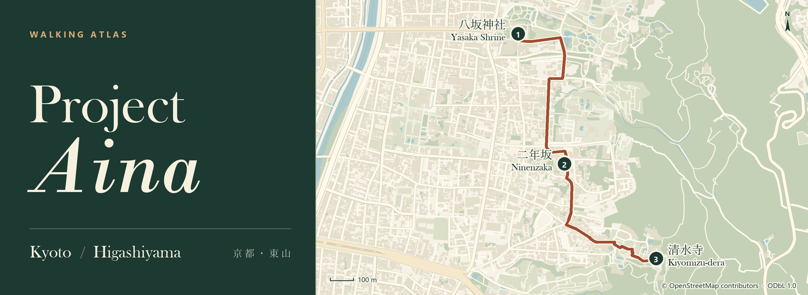
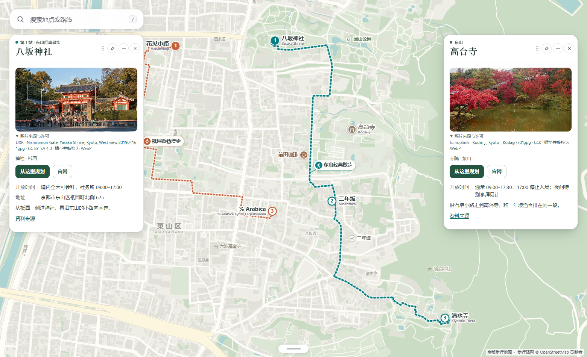

**简体中文** · [English](README.md)



从八坂神社走到清水寺，二年坂附近有一家想去的咖啡店。把它的照片和神社的开放时间并排放在地图上，看看要绕多远，再决定要不要加这一站。

**Project Aina** 是给喜欢自己安排行程的人做的步行地图。路线沿着街道留在图上，每个地点都能打开一扇独立的窗口。桌面上可以拖开几张卡片慢慢比较，手机上用一张可滑动的底部卡片完成规划。

## 在京都试走一段

1. 在地图上点 **八坂神社**，选 **从这里规划**。地图立即标出第 1 站，新路线以起点命名。
2. 再点 **二年坂**。在桌面上，第一张地点卡仍然开着，可以同时看两处的资料。选 **加入当前路线**，地图便沿街道画出两站之间的步行线。
3. 点 **完成路线**，再去看附近的咖啡店。想改主意时，点地图上的路线或打开 **我的路线**，就能调整站序、复制路线，或接着加站。



内置两条可以直接打开的散步路线。**东山经典散步**从八坂神社经二年坂到清水寺。**祇园街巷漫步**从花见小路经建仁寺到 % Arabica 京都东山。两条路线可以同时显示，也可以分别收起。

## 设计手记

### 看一家店，原来的路还在

从二年坂拐去喝杯咖啡，还顺路吗？做这个判断时，最有用的参照就是刚才画好的那条线。Aina 把「查看地点」和「编辑路线」做成两个独立动作。点开一家店，可以看照片、查营业时间、打开官网。选了「加入当前路线」，这家店才会成为行程的一站。路线按经纬度画在地图图层里，放大到一个街口，仍能看清要从哪里转弯。

### 地点卡可以挪，地图可以留白

桌面上可以把神社的开放时间放在左边，把咖啡店的卡片挪到右边，让中间的街道露出来。卡片的位置由正在规划的人决定。收起窗口时，地点和路线仍在原处。手机屏幕更窄，所以详情移到底部，向上滑读资料，向下收起看路。搜索框是首页的入口。管理、排序和比较都放进卡片，需要时再展开。

### 先定一站，再慢慢排

一次散步往往只从「我想去这儿」开始。所以第一站就能成为一条有名字的草稿，第二站加入后才出现沿街的步行线。上午走东山、下午去祇园，可以把两条路线同时铺在图上，看它们在哪里靠近。临时有了另一个走法，就复制一条试改。下次打开草稿，可以从上次停下的那一站接着排。

### 为什么先做步行

在东山，两枚图钉看起来只隔一条街，实际却可能要绕过院墙、走一段石阶才能到入口。路线的价值就在这几步里。京都示例随项目带着一份可步行的街巷路网，断网也能试排站序。到了其他城市，缺少的路段交给 Google Routes 计算。如果暂时找不到可走的路，两站依然会保存，那一段会留空。

## 本地运行

安装 Python 3.9 或更新版本，在项目目录启动。京都示例的地图、照片与步行路网都随仓库提供，首次试走无需 API 密钥。

```sh
git clone https://github.com/azhezyz/Project_Aina.git
cd Project_Aina
```

| 平台 | 启动命令 |
| --- | --- |
| Windows | `py -3 server.py` |
| macOS / Linux | `python3 server.py` |

启动后，在浏览器打开[中文版](http://127.0.0.1:5173/?lang=zh-CN)或[英文版](http://127.0.0.1:5173/?lang=en)。搜索框右侧的 **EN / 中文** 可以随时切换语言。网站会记住选择，两种语言共用已存路线和备注。行程按浏览器和网站地址保存在本机，下次用同一个地址打开，就能继续编辑。Windows 上也可以在 VS Code 的「终端 → 运行任务」中选择「启动 Project Aina」。

## 把地图带到其他城市

连接 Google 后，可以直接点底图上的店铺和景点，或在搜索框输入地名和城市后按回车。地点卡按资料可用情况显示照片、营业时间、评分和官网。支持嵌入的官网可以留在地图窗口里看。

1. 在自己的 Google Cloud 项目中关联结算，启用 **Maps JavaScript API**、**Places UI Kit**、**Places API (New)** 和 **Routes API**。
2. 创建浏览器 API 密钥，限制为以上服务，并允许实际使用的网站来源，例如 `http://127.0.0.1:5173/*`。
3. 点击页面右下角的底图状态，在设置中输入密钥即可在当前标签页使用。Windows 可运行 `py -3 server.py --set-key` 将密钥加密保存到当前用户。其他系统也可在启动前设置环境变量 `AINA_GOOGLE_MAPS_BROWSER_KEY`。

在线地图使用 Google 原生图层绘制站点与路线。京都东部优先使用内置步行路网，只有缺少的路段才向 Google Routes 请求。同一页面会复用已算出的路段。高级地点卡使用 Places UI Kit Pro，地点真名按需查询。在线服务的用量计入密钥所属项目。[Google Maps 密钥设置](https://developers.google.com/maps/documentation/javascript/get-api-key) · [Google Maps Platform 计费](https://developers.google.com/maps/billing-and-pricing/pricing)

<details>
<summary><strong>地图上的几个手势</strong></summary>

| 想做的事 | 操作 |
| --- | --- |
| 找一个地点 | 按 <kbd>/</kbd> 聚焦搜索框 |
| 给地图留出空间 | 拖动地点窗标题栏，或折叠单个窗口 |
| 一次收起所有地点窗 | 双击底部短横条，已显示的路线会保留 |
| 查看路线列表 | 向上拖动底部短横条，打开「我的路线」 |
| 收起底部卡片 | 按 <kbd>Esc</kbd> 或向下拖动 |

</details>

## 地图与影像

京都离线底图、步行路网和封面制图使用 © OpenStreetMap contributors 的数据，按 ODbL 1.0 提供。内置照片来自 Wikimedia Commons，每张照片的作者、原图、许可及 WebP 转换说明均可查阅。[OpenStreetMap 署名](https://www.openstreetmap.org/copyright) · [ODbL 1.0](https://opendatacommons.org/licenses/odbl/1-0/) · [照片署名清单](web/photo-catalog.js)
